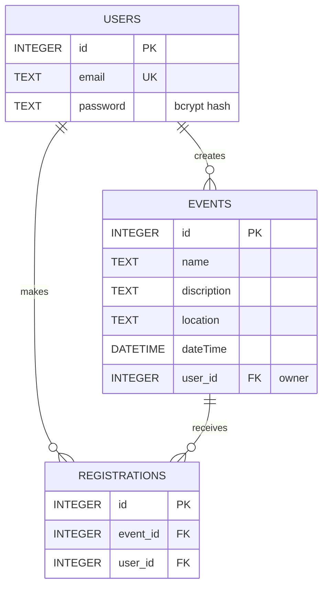

# Occasio

> A secure REST API for creating events and managing attendee registrations, built with Go.

**Occasio** is a RESTful backend, written in **Go**, for creating events and letting users register for them. It provides user signup and login with **JWT authentication**, full CRUD for events with owner-only edit/delete rules, and an event registration (RSVP) system, all backed by an embedded **SQLite** database.

> Repository: [`github.com/ujjwalsh-2209/Occasio`](https://github.com/ujjwalsh-2209/Occasio)

---

## Table of contents

1. [Features](#features)
2. [Tech stack](#tech-stack)
3. [Architecture](#architecture)
4. [Project structure](#project-structure)
5. [Data model](#data-model)
6. [Authentication flow](#authentication-flow)
7. [API reference](#api-reference)
8. [Getting started](#getting-started)
9. [Try it with curl](#try-it-with-curl)
10. [Design decisions](#design-decisions)
11. [Known limitations and roadmap](#known-limitations-and-roadmap)

---

## Features

- **User accounts**: sign up with email and password, log in to receive a token.
- **Secure passwords**: hashed with bcrypt (cost 14), never stored in plain text.
- **JWT authentication**: HS256-signed tokens that expire after 2 hours, signed with a secret read from the `JWT_SECRET` environment variable (never hardcoded).
- **Event CRUD**: anyone can browse events; authenticated users can create them.
- **Ownership rules**: only the user who created an event can update or delete it.
- **Event registration**: authenticated users can register for an event and cancel their registration.
- **Zero-setup database**: SQLite file (`api.db`) and all tables are created automatically on first start.

---

## Tech stack

| Layer | Choice |
|---|---|
| Language | Go (`go 1.27.3` as declared in `go.mod`) |
| HTTP framework | [Gin](https://github.com/gin-gonic/gin) v1.12.0 |
| Database | SQLite via [`mattn/go-sqlite3`](https://github.com/mattn/go-sqlite3) v1.14.53 (uses CGO) |
| Auth tokens | [`golang-jwt/jwt/v5`](https://github.com/golang-jwt/jwt) v5.3.1 |
| Password hashing | `golang.org/x/crypto/bcrypt` |
| Data access | Standard library `database/sql` with prepared, parameterised queries |

---

## Architecture

The code follows a simple layered design. Each layer only talks to the one below it.

```
          HTTP request
               │
               ▼
   ┌───────────────────────┐
   │  routes/  (handlers)  │  parse input, call models, shape JSON + status codes
   └───────────┬───────────┘
               │   protected routes pass through ▼
               │   ┌───────────────────────────┐
               │   │ middlewares/auth.go       │  verify JWT, put userId in context
               │   └───────────────────────────┘
               ▼
   ┌───────────────────────┐
   │  models/  (domain)    │  Event / User structs + SQL queries
   └───────────┬───────────┘
               ▼
   ┌───────────────────────┐
   │  db/  (persistence)   │  shared *sql.DB, schema creation
   └───────────────────────┘

   utils/ — cross-cutting helpers: bcrypt hashing and JWT create/verify
```

**Startup sequence (`main.go`)**

1. `main` checks that the `JWT_SECRET` environment variable is set and exits with an error if it is missing.
2. `db.InitDB()` opens `api.db`, sets the connection pool (10 open / 5 idle) and creates the tables if they do not exist.
3. `gin.Default()` creates the router with the built-in logger and panic-recovery middleware.
4. `routes.RegisterRoutes(server)` attaches the public and protected routes.
5. The server listens on **`:8081`**.

---

## Project structure

```
Occasio/
├── main.go                 # Entry point: checks JWT_SECRET, inits DB, registers routes, runs server on :8081
├── go.mod / go.sum         # Module definition and dependency checksums
├── .gitignore              # Ignores binaries, test artifacts, .env, and api.db
│
├── db/
│   └── db.go               # Opens SQLite, configures pool, creates users/events/registrations tables
│
├── middlewares/
│   └── auth.go             # Authenticate: validates the Authorization header, sets "userId"
│
├── models/
│   ├── event.go            # Event struct; Save, GetAllEvents, GetEventByID, Update, Delete,
│   │                       # Register, CancelRegistration
│   └── user.go             # User struct; Save (hashes password), ValidateCredentials
│
├── routes/
│   ├── routes.go           # Route table: public vs. authenticated groups
│   ├── events.go           # Handlers: getEvents, getEvent, createEvent, updateEvent, deleteEvent
│   ├── register.go         # Handlers: registerForEvent, cancelRegistration
│   └── users.go            # Handlers: signup, login
│
└── utils/
    ├── hash.go             # HashPassword / CheckPasswordHash (bcrypt, cost 14)
    └── jwt.go              # GenerateToken / VerifyToken (HS256, 2h expiry, secret from JWT_SECRET)
```

---

## Data model



`registrations` is a join table that represents a many-to-many relationship: a user can register for many events, and an event can have many attendees.

---

## Authentication flow

1. `POST /signup` stores the user with a bcrypt-hashed password.
2. `POST /login` checks the credentials and returns a JWT containing `email`, `userId`, and `exp` (now + 2 hours). The token is signed with HS256 using the secret from the `JWT_SECRET` environment variable.
3. For protected routes, send that token in the **`Authorization`** header. The middleware currently expects the **raw token** (no `Bearer ` prefix).
4. The middleware verifies the signature and expiry, checks that the signing method is HMAC, extracts `userId`, and stores it in the Gin context. Handlers read it with `context.GetInt64("userId")`.
5. Missing or invalid tokens get `401 Unauthorized`.

---

## API reference

**Base URL:** `http://localhost:8081`

| Method | Endpoint | Auth | Description |
|---|---|:---:|---|
| `POST` | `/signup` | No | Create a user account |
| `POST` | `/login` | No | Log in and receive a JWT |
| `GET` | `/events` | No | List all events |
| `GET` | `/events/:id` | No | Get one event by ID |
| `POST` | `/events` | Yes | Create an event (you become the owner) |
| `PUT` | `/events/:id` | Yes (owner) | Update an event |
| `DELETE` | `/events/:id` | Yes (owner) | Delete an event |
| `POST` | `/events/:id/register` | Yes | Register the current user for an event |
| `DELETE` | `/events/:id/register` | Yes | Cancel the current user's registration |

### JSON field names

> **Important:** the event structs have no `json` tags, so field names are the Go names, and the description field is spelled **`Discription`** in the code, the database column, and the API.
> Gin's JSON decoding matches keys case-insensitively, so request bodies can use `name`, `discription`, `location`, `dateTime`. A key named `description` will **not** be accepted. Responses use the Go names: `ID`, `Name`, `Discription`, `Location`, `DateTime`, `UserID`.

### Request and response examples

**`POST /signup`**

```json
{ "email": "alice@example.com", "password": "S3cretPass!" }
```
Response `201`: `{ "message": "user created successfully" }`

**`POST /login`**

```json
{ "email": "alice@example.com", "password": "S3cretPass!" }
```
Response `200`: `{ "message": "Login Successful", "token": "<jwt>" }`

**`POST /events`** (header `Authorization: <jwt>`)

```json
{
  "name": "Go Meetup",
  "discription": "Monthly Go developers meetup",
  "location": "Noida",
  "dateTime": "2026-12-20T18:30:00Z"
}
```
Response `201`:
```json
{
  "message": "Event created!",
  "event": {
    "ID": 1, "Name": "Go Meetup", "Discription": "Monthly Go developers meetup",
    "Location": "Noida", "DateTime": "2026-12-20T18:30:00Z", "UserID": 1
  }
}
```
`dateTime` must be an RFC 3339 timestamp. `name`, `discription`, `location`, and `dateTime` are all required.

**`PUT /events/:id`** takes the same body as create (all required fields must be present). Response `200`: `{ "message": "Event Updated successfully" }`

**`DELETE /events/:id`**. Response `200`: `{ "message": "event deleted successfuly" }`

**`POST /events/:id/register`**. Response `201`: `{ "message": "Registered" }`

**`DELETE /events/:id/register`**. Response `200`: `{ "message": "Cancelled" }`

### Status codes used today

| Code | When |
|---|---|
| `200` / `201` | Success / resource created |
| `400` | Invalid JSON body, missing required field, or non-numeric event ID |
| `401` | Missing/invalid token, bad login, or acting on an event you do not own |
| `500` | Database or unexpected errors (currently also returned when an event ID does not exist) |

---

## Getting started

### Prerequisites

- **Go** (version from `go.mod`, 1.27 or newer)
- **A `JWT_SECRET` value** (any long random string; see [Configuration](#configuration)). The server will not start without it.
- **A C compiler** (`gcc`). `go-sqlite3` uses CGO, so builds fail without one.
  - Linux: `sudo apt install build-essential`
  - macOS: `xcode-select --install`
  - Windows: install MinGW-w64 or TDM-GCC and make sure `gcc` is on your `PATH`

### Run locally

```bash
git clone https://github.com/ujjwalsh-2209/Occasio.git
cd Occasio

go mod download

# JWT_SECRET is required. Generate a random one and export it (Linux/macOS/Git Bash):
export JWT_SECRET="$(openssl rand -base64 32)"

go run .
```

On **Windows PowerShell**:

```powershell
$env:JWT_SECRET = "paste-a-long-random-string-here"
go run .
```

The API is now available at **http://localhost:8081**. The SQLite file `api.db` is created in the working directory on first run (and is git-ignored).

### Configuration

| Variable | Required | Description |
|---|:---:|---|
| `JWT_SECRET` | Yes | Secret used to sign and verify JWTs. Use a long random value and keep it out of Git. The server exits at startup if it is not set. |

A `.env` file is git-ignored, but it is **not** loaded automatically. Set the variable in your shell (or load the file with a tool such as `godotenv`).

### Build a binary

```bash
CGO_ENABLED=1 go build -o occasio .
JWT_SECRET="your-long-random-secret" ./occasio
```

---

## Try it with curl

Start the server first, with `JWT_SECRET` set (see [Getting started](#getting-started)).

```bash
# 1. Create a user
curl -X POST http://localhost:8081/signup \
  -H "Content-Type: application/json" \
  -d '{"email":"alice@example.com","password":"S3cretPass!"}'

# 2. Log in and keep the token
TOKEN=$(curl -s -X POST http://localhost:8081/login \
  -H "Content-Type: application/json" \
  -d '{"email":"alice@example.com","password":"S3cretPass!"}' | python3 -c "import sys,json; print(json.load(sys.stdin)['token'])")

# 3. Create an event
curl -X POST http://localhost:8081/events \
  -H "Content-Type: application/json" -H "Authorization: $TOKEN" \
  -d '{"name":"Go Meetup","discription":"Monthly meetup","location":"Noida","dateTime":"2026-12-20T18:30:00Z"}'

# 4. List events (public)
curl http://localhost:8081/events

# 5. Register for event 1, then cancel
curl -X POST   http://localhost:8081/events/1/register -H "Authorization: $TOKEN"
curl -X DELETE http://localhost:8081/events/1/register -H "Authorization: $TOKEN"
```

You can also import these requests into Postman or Insomnia. Remember to set the `Authorization` header to the raw token.

---

## Design decisions

- **Layered structure** keeps HTTP concerns (`routes`), business/data logic (`models`), and infrastructure (`db`, `utils`) separate and easy to test.
- **Prepared statements with `?` placeholders** are used for all queries, which protects against SQL injection.
- **Middleware-based auth** via a Gin route group: any route registered on the `authenticated` group is protected automatically.
- **Ownership check in the handler**: update and delete compare `event.UserID` with the `userId` from the token.
- **bcrypt cost 14** favours security over speed (signup and login each take noticeable CPU time).
- **Generic login error** ("Credentials invalid") is returned for both unknown email and wrong password, so attackers cannot discover which emails exist.
- **Embedded SQLite** means no external services are needed to run or demo the project.
- **Secrets from the environment**: the JWT signing key is never stored in the code, and the app refuses to start without it (fail fast instead of running with an empty key).

---

## Known limitations and roadmap

This is a solid foundation; the items below are what I would tackle next, in priority order.

### Correctness and security (highest priority)

- [x] **JWT secret now comes from the `JWT_SECRET` environment variable**, and the server refuses to start without it.
- [ ] **Remove the old secret from the file**: delete the commented-out `supersecret` line in `utils/jwt.go`. The old value is still in Git history, so treat it as public and never reuse it anywhere real.
- [ ] **Unchecked claim read in `VerifyToken`**: `claims["userId"].(float64)` panics if the claim is missing or has the wrong type. Check the `ok` value, and pin the algorithm with `jwt.WithValidMethods([]string{"HS256"})`.
- [ ] **Nil-pointer panic in `updateEvent`**: `event.UserID` is read *before* the error from `GetEventByID` is checked, so updating a non-existent event panics (Gin's recovery turns it into a 500). Check `err` first.
- [ ] **Return proper status codes**: `404` when an event or row is not found (currently `500`), `403` for "not the owner" (currently `401`), `409` for a duplicate email on signup (currently `500`).
- [ ] **Prevent duplicate registrations** by adding `UNIQUE(event_id, user_id)` to `registrations` and returning a clear error.
- [ ] **`cancelRegistration` ignores errors**: the ID-parse error is discarded, it never checks that the event exists, and it reports "Cancelled" even if the user was never registered.
- [ ] **Foreign keys are not enforced**: SQLite needs `PRAGMA foreign_keys = ON`. Deleting an event currently leaves orphaned rows in `registrations`; add `ON DELETE CASCADE` or delete them explicitly.
- [ ] **Input validation**: require a valid email format and a minimum password length.

### API quality

- [ ] Fix the `Discription` typo and add explicit `json` tags (e.g. `json:"description"`). This changes the public API, so plan it as a versioned change (`/v1`).
- [ ] Accept the standard `Authorization: Bearer <token>` format.
- [ ] Move configuration (port, DB path, JWT secret, token lifetime) to environment variables.
- [ ] Replace `panic` calls in `db` with returned errors and add graceful shutdown.
- [ ] Remove the unused package-level `events` slice in `models/event.go`, and avoid `SELECT *` with positional `Scan`.

### Features

- [ ] Event capacity and "event full" handling
- [ ] Endpoints to list *my* registrations and an event's attendees (for organizers)
- [ ] Pagination, filtering, and search on `GET /events`
- [ ] Wrap the DB layer with transactions where multiple statements must succeed together

### Engineering practices

- [ ] Unit and integration tests (`net/http/httptest` with an in-memory SQLite database)
- [ ] Dockerfile and GitHub Actions CI (`go vet`, `go test`, build)
- [ ] OpenAPI/Swagger documentation
- [ ] Rate limiting on `/login`, structured logging, and a migration tool such as `golang-migrate`

---


